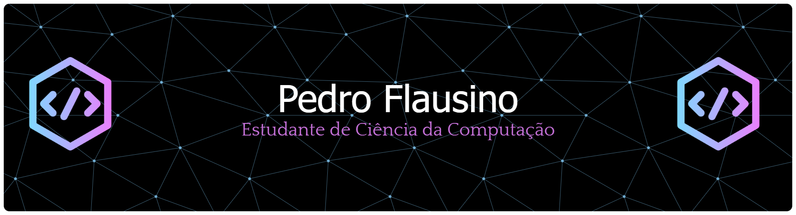

  

  
  &nbsp;&nbsp;
  
  &nbsp;&nbsp;
  
  &nbsp;&nbsp;
  
  &nbsp;&nbsp;
  

-----

&nbsp;Sobre mim

<table>
<tr>
<td width="55%" valign="middle">

Meu nome é **Pedro Flausino Mendonça**, tenho 19 anos e moro em **Belo Horizonte**.
Curso **Ciência da Computação** na PUC Minas e sou **monitor de Algoritmos e
Estruturas de Dados I**.

Gosto de aprender na prática: montar o projeto, quebrar a cabeça com um bug e ver
as coisas funcionando. Foi assim que nasceu o meu [portfólio](https://www.flausino.dev/),
um site com estética de terminal feito do zero em React, TypeScript e Vite — com
temas trocáveis, terminal por comandos, estante de livros e mapa de viagens.

Hoje procuro a **primeira oportunidade como desenvolvedor**, para aprender com um
time de verdade.

</td>
<td align="center">

</td>
</tr>
</table>

-----

&nbsp;Projetos

**Portfólio pessoal** &nbsp;·&nbsp; [`www.flausino.dev`](https://www.flausino.dev/) &nbsp;·&nbsp; [código](https://github.com/PedroFlau/pedroflausino-portifolio)

Site pessoal com estética de terminal, construído do zero em **React 19**,
**TypeScript** e **Vite**. Tem temas trocáveis (incluindo um do Império Galáctico),
terminal navegável por comandos, estante de livros, mapa de viagens com os lugares
onde já estive e integração com a **API do WakaTime**.

 

**visualize.it** &nbsp;·&nbsp; em equipe

Plataforma web para visualizar, na prática, os conceitos de **Algoritmos e Estruturas
de Dados II** — as estruturas deixam de ser diagrama no slide e passam a ser algo que
dá para mexer. Desenvolvido em equipe, em **TypeScript**.

-----

&nbsp;Linguagens e ferramentas

  
  &nbsp;&nbsp;
  
  &nbsp;&nbsp;
  
  &nbsp;&nbsp;
  
  &nbsp;&nbsp;
  
  &nbsp;&nbsp;
  
  &nbsp;&nbsp;
  

-----

&nbsp;WakaTime

  

-----
